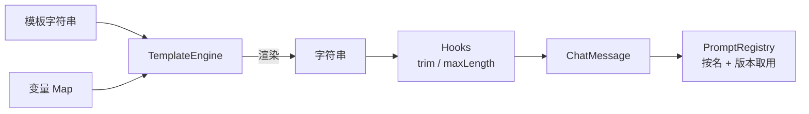

<div align="center">

# Quill

### 面向大模型的提示词工程工具包 · 零依赖 · 纯 Java 21

[](https://github.com/WsNodeX/quill/stargazers)
[](https://github.com/WsNodeX/quill/releases)
[](LICENSE)

</div>

---

提示词一旦超过二十行，就会变成散落在代码里的字符串拼接。Quill 把它们变成可模板化、
可校验、可复用的东西：变量声明、过滤器、控制流、聊天消息，全部用 JDK 21 标准库实现。

## 快速开始

```java
import quill.core.TemplateEngine;

String src = """
        Dear {{ name | upper }},

        
        Thanks for being a VIP member!
        
        Consider upgrading to VIP.
        

        Your orders:
        
        {{ loop.index }}. {{ o | capitalize }}
        
        """;

Map<String, Object> vars = new LinkedHashMap<>();
vars.put("name", "ada lovelace");
vars.put("vip", true);
vars.put("orders", List.of("calculus book", "abacus", "notebook"));

System.out.println(TemplateEngine.DEFAULT.render(src, vars));
```

```bash
javac -d build $(find src/main/java -name '*.java')
java -cp build quill.examples.Demo       # 端到端演示，无需联网
```

## 模板能力

| 语法 | 作用 |
|---|---|
| `{{ name }}` | 变量插值 |
| `{{ name \| upper }}` | 过滤器链，可叠加 |
| ` …  … ` | 条件分支 |
| `` / `{{ loop.index }}` | 循环与循环元信息 |

`VariableSpec` 声明变量是否必填、类型和默认值 —— 缺变量时在渲染前报错，而不是渲染出一段
`Dear {{ name }}` 发给用户。

## 聊天消息与注册表

```java
import quill.core.ChatMessage;
import quill.registry.PromptRegistry;

List<ChatMessage> msgs = List.of(
    ChatMessage.system("You are terse."),
    ChatMessage.user("Explain backprop in one sentence.")
);
```

| 类型 | 作用 |
|---|---|
| `Prompt` | 名称、版本、描述、模板、变量声明的打包单元 |
| `PromptRegistry` | 按名称与版本取 Prompt，便于 A/B 与回滚 |
| `Hooks` | 输出后处理：`trim()`、`collapseWhitespace()`、`maxLength(n)` |
| `Filters` | 渲染期值变换；`exists(name)` 可探测，可扩展 |

## 数据流



## 安装

把 `src/main/java/quill` 整个目录拷进你的项目即可 —— 没有传递依赖，不需要构建配置。

## 测试

```bash
java -jar junit-platform-console-standalone-1.10.2.jar --class-path build --scan-class-path
```

62 个 JUnit 5 用例。

## 限制

- **模板语言是自己写的。** 支持变量、过滤器、`if`、`for`，不支持函数定义、模板继承、
  自定义标签。要更完整的语法，用 Jinja/Mustache 的 Java 移植。
- **不做调用。** Quill 只负责把提示词组装好；发请求、重试、解析流式响应是你自己的事。
- **没有内置 token 计数。** 不同模型的切词规则不同，这里不猜。
- **无基准数据。** 仓库里没有吞吐实测，README 不编这类数字。

## License

[MIT](LICENSE)
